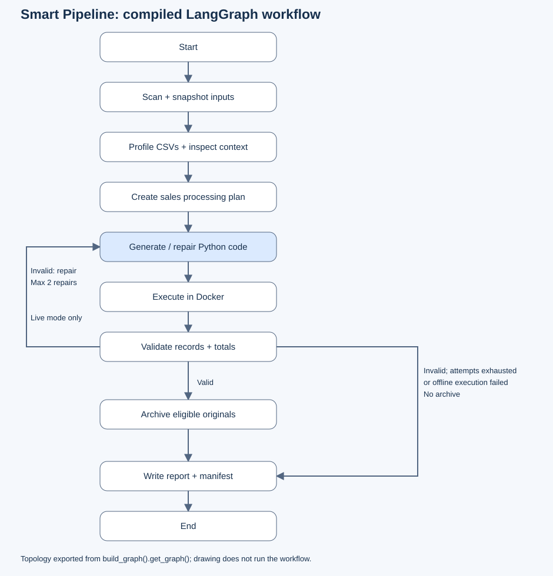

# Smart Pipeline

## 1. What this program does

Smart Pipeline processes a folder of sales CSV files using a single AI coding model and a LangGraph workflow. The model writes a Python program, the application executes it inside Docker, and trusted Python checks the results before archiving eligible originals.

The result is cleaned combined sales data, revenue and order counts by month/category, rejected-row findings, a readable report, and a traceable archive. An offline demo uses a reference program instead of calling a model.

### Inputs and sales rules

Compatible CSVs must have the following normalized columns:

| Column | Example headers | Required value |
|---|---|---|
| `order_id` | `Order ID`, `order_id` | Nonempty stable order identifier. |
| `order_date` | `Order Date`, `order_date`, `date` | ISO date, e.g. `2026-01-05`. |
| `category` | `Category`, `category` | Nonempty category. |
| `revenue` | `Revenue`, `revenue`, `sales` | Finite, nonnegative decimal with no fractional cents. |

CSV input uses UTF-8 with optional BOM. Delimiters are detected among comma, semicolon, tab and pipe. Files are processed in sorted relative-path order; the first valid record for an order ID wins. Later valid records with that ID are rejected as duplicates. Invalid dates, amounts, missing required values and incorrect field counts produce rejected rows. A file-wide CSV parse failure excludes the whole file.

Revenue assumes a single currency and one record per order. Order-line data, negative refunds, currency conversion and locale-specific dates/numbers need changes to the processing contract and validator. Compatible headers do not establish business meaning: confirm that selected files describe the same kind of sales.

JSON is validated and excerpted; PDF text is extracted from up to five pages; logs/text are excerpted with error lines. These findings stay in `context.json`. Input Python scripts are never executed. Incompatible CSVs and other file types remain in the input folder. All inventoried files are snapshotted, including unprocessed ones.

### Results

| Artifact | Purpose |
|---|---|
| `outputs/master_data.csv` | Clean records with source file, source row and original values. |
| `outputs/summary.csv` | Revenue and accepted order counts by month/category. |
| `outputs/rejected_rows.csv` | Excluded records, rejection reasons and original values. |
| `outputs/report.md` | Calculated findings, assumptions, file disposition, status and errors. |
| `generated_pipeline.py` | Latest program written and executed by the coding model, or the offline reference. |
| `outputs/execution.log` | Latest generated program's stdout/stderr. |
| `manifest.json` | Recorded run state, input hashes, validation results and archive destinations. |
| `archive_journal.json` | Pending/completed archive operations, created when archiving starts. |

The default layout is:

```text
smart_pipeline/
  app.py                    Command-line entry point
  graph.py                  Actual LangGraph workflow
  draw_workflow.py          Local workflow diagram generator
  models.py                 Interchangeable model configuration
  state.py                  RunState definition
  reference_pipeline.py     Processing contract and offline program
  tools/                    Controlled file functions
  sample_data/              Reusable messy sample folder
  tests/                    Automated tests
  docs/workflow.svg         Generated workflow image
  docs/workflow.mmd         Mermaid from the compiled graph
  work/
    checkpoints.sqlite
    runs/<run_id>/          Snapshots, plan, context, script, outputs and manifest
    archive/<run_id>/       Archived originals with relative paths preserved
```

## 2. LLM, tools and memory used

| Component | Implementation |
|---|---|
| Default LLM | OpenAI `gpt-4.1-mini`, through `langchain-openai==1.2.2`. |
| Provider selection | LangChain `init_chat_model`, centralized in `models.py`; provider/model can change without editing the graph. |
| Agent | One coding model, reused for an initial program and up to two repairs. Offline mode makes no model calls. |
| Orchestration | `langgraph==1.2.4` and `langchain==1.3.6`. |
| File processing | Python standard library; `pypdf==6.10.2` for bounded PDF text extraction. No pandas is required. |
| Execution | Docker Linux container with read-only snapshots, disabled network and resource limits. |
| Working memory | Explicit `RunState`: request, inventory, profiles, plan, script path, attempt count, results, artifact paths, archive entries, errors and status. |
| Persistent memory | LangGraph `SqliteSaver` from `langgraph-checkpoint-sqlite`, stored in `smart_pipeline/work/checkpoints.sqlite`. The run ID is the checkpoint thread ID. |
| Disk storage | Full input snapshots, generated code, reports and archive journals. State stores paths and profiles, including small CSV samples. |
| Cross-run learning | None. No accumulated chat history, embeddings, semantic memory, vector database or retrieval-augmented generation. Checkpoints preserve run progress. |

The controlled tools are application Python functions called by graph nodes:

| Function | Responsibility |
|---|---|
| `scan_directory` | Inventory relative paths, file types, sizes and SHA-256 hashes. |
| `profile_csv` | Inspect headers, three sample rows, row counts and basic quality statistics. |
| `read_context_file` | Inspect bounded JSON, PDF and log/text content. |
| `save_generated_script` | Save generated code in the current run directory. |
| `execute_script` | Run the program in Docker and capture its result. |
| `validate_outputs` | Reconcile schemas, accepted records, provenance, rejections and totals against sources. |
| `archive_processed_files` | Check unchanged originals and journal verified archive operations. |
| `restore` | Copy archived originals back without overwriting conflicting files. |

The model does not freely choose tools or control archiving. Trusted application code owns these operations.

## 3. How to run this program

Use PowerShell **from the repository root**, the folder containing `smart_pipeline/`. You need uv and Docker Desktop running Linux containers. The local uv environment already exists at `smart_pipeline/.venv`; on another machine, create it as follows:

```powershell
uv python install 3.11
uv venv smart_pipeline/.venv --python 3.11
uv pip sync --python smart_pipeline/.venv/Scripts/python.exe smart_pipeline/requirements.lock.txt
uv pip check --python smart_pipeline/.venv/Scripts/python.exe
docker version
docker build -t smart-pipeline-python:local smart_pipeline
```

`requirements.txt` lists direct targets; `requirements.lock.txt` records the verified default environment. Keep it separate from the older root `.venv`.

### Guided demo: exactly what to enter

The app does **not** ask interactive questions. Type your folder and choices as command-line arguments, then press Enter. Do not type the PowerShell `PS ...>` prefix. Use a fresh destination name if one below already exists.

**First, try the offline demo without an API key:**

```powershell
Copy-Item -Recurse smart_pipeline/sample_data walkthrough_offline_inputs
.\smart_pipeline\.venv\Scripts\python.exe -m smart_pipeline.app walkthrough_offline_inputs --offline
```

Wait for completion; no further input is needed. Offline mode uses the reference program but still runs Docker, validation and archiving. Expect 6 source rows, 3 accepted, 3 rejected including 1 duplicate, and total revenue **65.50**. Only `january.csv` and `february.csv` are archived; the six other sample files remain.

The terminal shows stage updates and ends with a path similar to:

```text
{"validate": {"validation_result": {"valid": true, "source_rows": 6, "accepted": 3, "rejected": 3, "duplicates": 1, "revenue": "65.50"}, "status": "validated", "errors": []}}
...
Reports: C:\...\smart_pipeline\work\runs\<generated_run_id>
```

This is output, not a command to enter. Open `outputs/report.md` or `outputs/summary.csv` inside the actual printed directory. For example, replace this path before running:

```powershell
Invoke-Item 'C:\your-project\smart_pipeline\work\runs\YOUR_ACTUAL_RUN_ID\outputs\report.md'
```

**Next, run with the coding model:** replace the key placeholder with your own key. Live calls send sample-derived context to the selected provider and can incur charges.

```powershell
$env:OPENAI_API_KEY = 'PASTE_YOUR_OPENAI_API_KEY_HERE'
Copy-Item -Recurse smart_pipeline/sample_data walkthrough_agent_inputs
.\smart_pipeline\.venv\Scripts\python.exe -m smart_pipeline.app walkthrough_agent_inputs --provider openai --model gpt-4.1-mini --request 'Combine the compatible sales CSV files, reject invalid rows, remove duplicate order IDs, and summarize revenue and order counts by month and category.'
```

| Information you supply | Where to enter it |
|---|---|
| Folder | Immediately after `smart_pipeline.app`, e.g. `walkthrough_agent_inputs`. |
| Request | After `--request`, enclosed in quotes. |
| Provider and model | After `--provider` and `--model`. |
| Custom workspace | After `--workdir`. It must be separate from the input folder; neither can contain the other. |
| Credentials | Provider-specific environment variables before running the command. `.env` is not automatically loaded. |

There is no archive confirmation prompt: validated eligible files are archived automatically. Copy the samples rather than processing the reusable `sample_data/` folder directly. Without a folder argument the app exits with `An input folder is required`; rerun the full command with that argument.

For your own paths, quote names containing spaces:

```powershell
.\smart_pipeline\.venv\Scripts\python.exe -m smart_pipeline.app 'C:\Sales Demo\incoming' --workdir 'C:\Sales Demo\workspace' --request 'Combine sales data and summarize revenue by month and category.'
```

### Change provider with configuration

Install only the integration you need and set its credential environment variable. Use model IDs available in your account or local service; the following IDs are placeholders.

```powershell
# Anthropic: set ANTHROPIC_API_KEY
uv pip install --python smart_pipeline/.venv/Scripts/python.exe langchain-anthropic
.\smart_pipeline\.venv\Scripts\python.exe -m smart_pipeline.app walkthrough_agent_inputs --provider anthropic --model YOUR_CLAUDE_MODEL_ID

# Google Gemini: set GOOGLE_API_KEY
uv pip install --python smart_pipeline/.venv/Scripts/python.exe langchain-google-genai
.\smart_pipeline\.venv\Scripts\python.exe -m smart_pipeline.app walkthrough_agent_inputs --provider google_genai --model YOUR_GEMINI_MODEL_ID

# Ollama: start the service and pull your chosen model first
uv pip install --python smart_pipeline/.venv/Scripts/python.exe langchain-ollama
.\smart_pipeline\.venv\Scripts\python.exe -m smart_pipeline.app walkthrough_agent_inputs --provider ollama --model YOUR_LOCAL_MODEL --base-url http://localhost:11434
```

Use fresh input copies for successive runs. OpenAI-compatible services can use `--provider openai --model YOUR_MODEL --base-url http://localhost:8000/v1`, with credentials required by that service.

| Flag | Environment fallback | Default |
|---|---|---|
| `--provider` | `SMART_PIPELINE_PROVIDER` | `openai` |
| `--model` | `SMART_PIPELINE_MODEL` | `gpt-4.1-mini` for OpenAI; required otherwise |
| `--base-url` | `SMART_PIPELINE_BASE_URL` | Integration default |
| `--model-options` | `SMART_PIPELINE_MODEL_OPTIONS` | Empty JSON object |

Flags override environment fallbacks. For example, set `$env:SMART_PIPELINE_PROVIDER = 'ollama'` and `$env:SMART_PIPELINE_MODEL = 'YOUR_LOCAL_MODEL'` to reuse the same run command. Provider options such as `--model-options '{"temperature":0}'` are passed through; use options your model accepts. Clear endpoint/options variables when changing providers. Offline mode bypasses model configuration.

After adding a provider integration, run `uv pip check` again. If needed, freeze that environment to a separate provider-specific lockfile; the supplied lockfile covers the default setup.

### Resume and restore

Replace `YOUR_ACTUAL_RUN_ID` with the alphanumeric directory name printed after a run:

```powershell
# Continue pending work from an interrupted offline run
.\smart_pipeline\.venv\Scripts\python.exe -m smart_pipeline.app walkthrough_offline_inputs --offline --resume YOUR_ACTUAL_RUN_ID

# Restore archived originals, retaining archive copies
.\smart_pipeline\.venv\Scripts\python.exe -m smart_pipeline.app walkthrough_offline_inputs --restore YOUR_ACTUAL_RUN_ID
```

Use the original input path, offline setting and custom work directory. In live mode, omit `--offline` and supply the original model settings again; provider configuration is not saved in `settings.json`. Resume does not restart completed runs or automatically retry a terminal `failed`/`archive_failed` result. Inspect the journal after partial archive failures. Restore skips identical existing files and refuses conflicting ones. There is no permanent-delete option.

### Generate the actual LangGraph workflow diagram

The application already executes a real LangGraph defined in `graph.py`. To recreate its diagram, run:

```powershell
.\smart_pipeline\.venv\Scripts\python.exe -m smart_pipeline.draw_workflow
Invoke-Item smart_pipeline/docs/workflow.svg
```

I ran this exporter successfully. It produces:

- [workflow.svg](docs/workflow.svg): standalone image you can open in a browser, generated locally without an external rendering service.
- [workflow.mmd](docs/workflow.mmd): Mermaid source exported from the compiled LangGraph.

No model call, API key, Docker execution or input processing is needed to draw it. Choose another destination with `--output-dir 'C:\Sales Demo\diagrams'`.



The exporter builds the real graph without invoking its nodes:

```python
from pathlib import Path
from smart_pipeline.graph import build_graph

workflow = build_graph(model=None, archive_root=Path('unused_archive'))
mermaid = workflow.get_graph().draw_mermaid()
Path('workflow.mmd').write_text(mermaid, encoding='utf-8')
```

To create or extend the workflow in code:

1. Declare fields in `RunState` in `state.py`.
2. Implement a node as a function accepting state and returning updated fields.
3. Register it with `StateGraph(RunState).add_node(...)` inside `build_graph`.
4. Connect fixed stages with `add_edge`; route validation with `add_conditional_edges` and an explicit destination map.
5. Compile with a checkpointer for persistence. `app.py` uses `SqliteSaver` and the run ID as `thread_id`, then calls `graph.stream(...)` to execute and display updates.
6. Run tests and regenerate the diagrams. If adding/removing nodes, update the local SVG positions in `draw_workflow.py`; Mermaid topology is exported automatically.

Keep schema/processing changes synchronized across the reference program, coding prompt and independent validator.

## 4. Relevant information about the AI agent

### Execution workflow and responsibilities

The actual node sequence is:

```text
scan -> profile -> plan -> generate -> execute -> validate
                                  ^                  |
                                  |--- repair -------| invalid, attempts remain
                                                     |
                           valid -> archive -> report -> end
                           invalid, exhausted -> report -> end
```

| Stage | What it does |
|---|---|
| Scan | Inventories/hashes files, snapshots them and checks copied hashes. |
| Profile | Inspects CSV headers, sample rows and quality counts; saves other context inspection locally. |
| Plan | Selects required sales columns and records fixed assumptions. This is deterministic, not an LLM planning call. |
| Generate | Sends the request, profiles, plan and reference contract to the coding model; saves its code. |
| Execute | Runs the program inside Docker against snapshots. |
| Validate | Independently calculates expected accepted records and totals from the sources, and checks required CSV schemas and reconciliation. |
| Repair | Reuses the same model with execution/validation feedback. Maximum three executions in live mode; one in offline mode. |
| Archive | Checks originals against scanned hashes, journals each operation, copies/verifies eligible files and removes originals. |
| Report | Writes deterministic Markdown and a manifest after the archive stage, or directly after exhausted validation failures. |

The model writes processing code; trusted application code controls file operations and cleanup. This is not a free-running tool-calling agent. Requests cannot redefine output schemas or override validation and archive policy. Final report metrics and narrative come from deterministic Python, not model estimates.

### Data shared with the model and retained locally

Live coding calls include your request, file paths, assumptions, reference program, all CSV profiles (including up to three sample rows per CSV, even incompatible files), and latest execution/validation feedback. The prompt builder does not upload whole input files. It does not currently send `context.json` PDF/log/JSON excerpts or the full execution log. Each repair adds a model call; SDK retries may add requests. Prior conversation messages are not accumulated.

Treat external provider use as sharing those prompt contents. Run folders, snapshots, terminal output, profiles, checkpoints and manifests can contain sensitive paths or original values. They are not automatically encrypted or purged. Generated code and logs are overwritten on repairs; previous versions are not separately retained. The manifest does not record a complete model/prompt history.

File contents are framed as data, but prompt instructions alone are not a security boundary. Docker restrictions and trusted validation provide separate controls.

### Execution and cleanup limits

Generated code has no container network access or application API credentials. Inputs, script, plan and root filesystem are read-only. It runs as a non-root user with dropped capabilities and no-new-privileges, limited to 256 MB memory, one CPU, 32 processes, 60 seconds, a 32 MB temporary output area and a 16 MiB per-file limit. Its writable export mount is limited to the current run's output folder but has no aggregate disk quota. Docker is required; there is no local execution fallback.

Host-side scanning, profiling and PDF parsing are not container-isolated. Use trusted local documents for this demo. Inputs over 20 MB stop the run; context inspection skips files over 2 MB. CSV processing is not streaming and there is no total-input-size cap. PDF inspection flags empty extracted text for OCR but does not perform OCR. Header compatibility does not guarantee semantic compatibility.

Only selected, validated files are eligible for archiving. A file may be archived even when all its records were rejected, because those rows were accounted for. Invalid or unselected files stay in place. Do not modify inputs during processing or use concurrent processes for one run. Hash checks do not lock files; checkpoint writes and file operations are not a single transaction.

Reports are written after archiving. Report failure can therefore leave successfully archived inputs without a final report. The journal and archived copies provide recovery evidence. An `archive_failed` run can have some files already archived; inspect the journal rather than assuming none moved.

### Troubleshooting and verification

| Symptom | What to check |
|---|---|
| Docker missing/unreachable | Start Docker Desktop with Linux containers; ensure `docker version` shows client and server in the current shell. |
| Image missing | Build `smart-pipeline-python:local`. |
| Integration/key missing | Install the selected provider package in this environment and set its credential variable. `.env` is not auto-loaded. |
| No compatible CSV | Check headers, UTF-8 encoding, parse errors and whether an earlier run archived the originals. |
| Validation failed | Read the generated script, execution log, rejected rows and manifest; confirm your data matches the fixed contract. |
| Source changed/archive collision | Preserve both copies and inspect hashes and journal before manual recovery. |
| No report | Read `failure.json` if present and terminal errors. Setup errors may occur before a run folder is created. |
| Resource limit reached | Reduce input size or inspect generated code. This version targets small demo datasets. |

```powershell
.\smart_pipeline\.venv\Scripts\python.exe -m smart_pipeline.app --help
.\smart_pipeline\.venv\Scripts\python.exe -m unittest discover -s smart_pipeline/tests -v
```

Verified on 2026-11-05 with uv 0.13.6, Python 3.11.18 and Docker Desktop's Linux engine: all 50 packages pass compatibility checks; all 11 automated tests pass; the real offline Docker demo reconciled revenue 65.50 and archived only two selected CSVs. Completed-run resume did no further processing, and restoring twice preserved all eight original sample hashes. The recorded offline run is `work/runs/7132198de27e451b99acc8843c191aef/`.

Live model generation and alternative-provider calls remain unverified; provider tests use mocks. The development session's automatic approval review blocked a live API-key test pending explicit authorization to send sample-derived context. That review is not a feature of this application. The current interface is a CLI, with local report files rather than a graphical folder selector or download screen.
